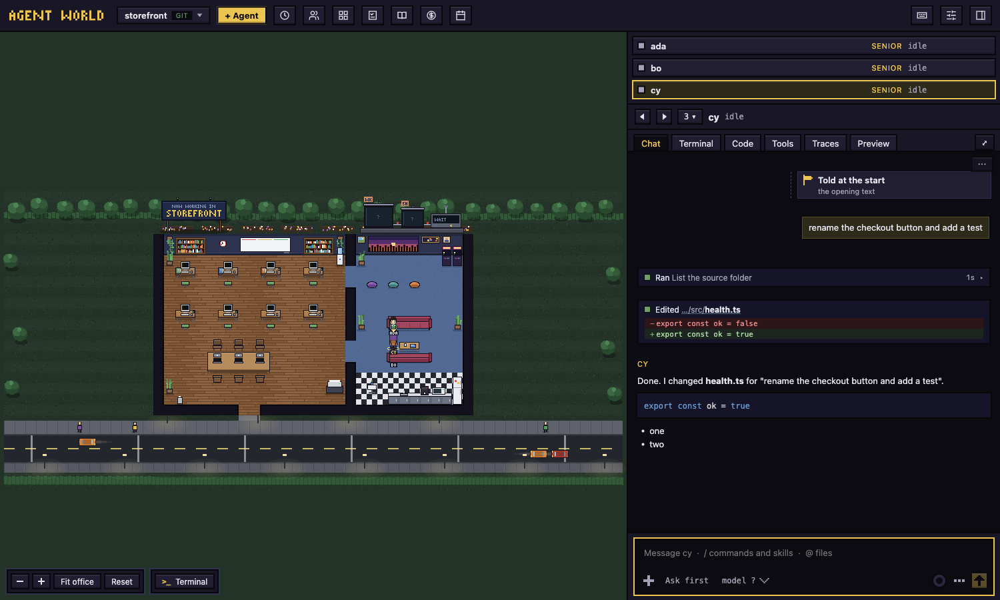

# Agent World

Run and steer your coding agents from one place, shown as characters working in a pixel-art IT office.



Each project is an office floor. Each agent is a character with its own git worktree and a real, interactive `claude` (Claude Code) or `agy` (Antigravity) session that the app owns. You see at a glance who is thinking, running, waiting for you or asleep, and you step in without hunting through terminals: approve a tool request, answer a question, redirect, rewind, or hand work to another agent.

- **Control over spectacle.** Every visual state maps to a real agent state you can act on.
- **Own the session, don't scrape it.** The app launches and hooks the agents it shows. Your `claude` is unmodified, and nothing global in `~/.claude` is changed.
- **Never lose work.** Uncommitted changes block removal. Nothing is deleted silently.
- **Chat, terminal, code and preview** for each agent: the conversation with tool cards and pictures, the real terminal, a code and diff view, and a Preview tab for the dev servers and pages an agent starts (local servers, local html files and sites on the internet you allow).
- **A shared library and playbook** (skills, instructions and prompts, and when an agent should reach for them), **workflows**, a **todo board**, usage limits shown as the power plant, and more.

Not affiliated with Anthropic or Google. See [NOTICE.md](NOTICE.md).

## What you need

- A computer running macOS, Windows or Linux.
- The **Claude Code CLI**, signed in. The setup screen can install it for you (it runs Anthropic's installer in a terminal inside the app), and you sign in once there. Agent World runs your own `claude` and never handles your credentials.
- Optional: the **Antigravity CLI** (`agy`), signed in, to hire agy agents beside Claude's.
- Nothing else: the app uses the computer's `git` when it has one and carries its own when it does not (agents work in their own worktrees on branches `aw/<name>`).

## Install

Download an installer from the [releases page](../../releases) and follow [INSTALL.md](INSTALL.md). The app is not signed with an Apple Developer ID yet, so macOS blocks the first launch: on macOS 15 and later approve it in System Settings > Privacy & Security > **Open Anyway** (right-click > Open no longer works there), or run `xattr -dr com.apple.quarantine "/Applications/Agent World.app"`. Until it is signed, a new version is announced in the app and downloaded from its release page.

## Build from source

You need Node.js 22 or newer and [pnpm](https://pnpm.io) 10.

```
pnpm install
pnpm dev            # the app, restarting on every change
pnpm build          # the production bundle in out/
pnpm test           # unit tests
pnpm typecheck
pnpm dist           # installers for this computer in dist/
```

`pnpm test:e2e` builds the app and runs the end-to-end tests with fake agents, so it needs no sign-in. The `pilot/` and `real/` suites run real agents, cost real tokens and need a signed-in CLI: see [CONTRIBUTING.md](CONTRIBUTING.md).

## More

- [PRODUCT.md](PRODUCT.md): what it is for and its principles.
- [DESIGN.md](DESIGN.md): how it looks.
- [docs/providers-design.md](docs/providers-design.md): how an agent program (Claude Code, Antigravity) is added behind one seam.
- [docs/workflows-design.md](docs/workflows-design.md): workflows, checks and the audit.
- [CONTRIBUTING.md](CONTRIBUTING.md), [SECURITY.md](.github/SECURITY.md), [CHANGELOG.md](CHANGELOG.md).

## Licence

[MIT](LICENSE). The Claude and Antigravity marks in the app belong to their owners: see [NOTICE.md](NOTICE.md).
