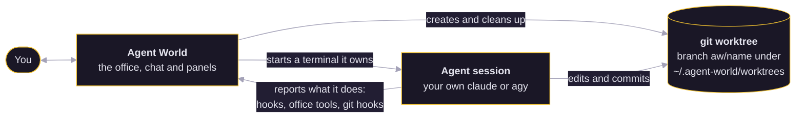

<p align="center">
  
</p>

<p align="center">
  
  
  
  
</p>

<p align="center"><b>Run and steer your coding agents from one place, shown as characters working in a pixel-art IT office.</b></p>


Each project is an office floor. Each agent is a character with its own git worktree and a real, interactive `claude` (Claude Code) or `agy` (Antigravity) session that the app owns. You see at a glance who is thinking, running, waiting for you or asleep, and you step in without hunting through terminals.

- **Control over spectacle.** Every visual state maps to a real agent state you can act on.
- **Own the session, don't scrape it.** The app launches and hooks the agents it shows. Your `claude` is unmodified, and nothing global in `~/.claude` is changed.
- **Never lose work.** Uncommitted changes block removal. Nothing is deleted silently.

##  Quick start

1. **Download** the installer for your computer from the [releases page](../../releases): on a Mac, the `arm64` dmg for Apple silicon (M1 and later) or the `x64` dmg for Intel. Open it and drag **Agent World** into Applications.
2. **Open it once.** The Mac app is not signed with an Apple Developer ID yet, so macOS blocks the first launch. On macOS 15 and later, try to open it, then go to System Settings > Privacy & Security and press **Open Anyway**. Older macOS and the terminal route are in [INSTALL.md](INSTALL.md).
3. **Follow the setup screens.** Nothing has to be installed first: the app carries its own `git`, and setup installs the Claude Code CLI for you and has you sign in once, in a terminal inside the app. Agent World runs your own `claude` and never handles your login. Antigravity (`agy`) is optional.
4. **Hire.** Pick a project folder, click **+ Agent**, name it, and the character walks in.


More in the [user guide](#user-guide).

## Features

###  The office

Each agent works at a desk, and what the character does is what the agent does: thinking, researching, implementing, running, delegating or waiting for you. An agent that is asleep leaves the floor and stays in the list. Click a character or its row to open its chat.


###  Chat

The conversation of each agent is built from Claude's saved transcript and the real terminal: tool cards, edits as diffs, pictures, and dialogs for what the agent asks. Rewind, queue messages, ask a side question with `/btw`, or run a command with `!`.


###  Permissions answered in the world

A request shows above the character and in the panel. Allow or deny it in one click, or answer in the agent's own terminal. After five minutes it falls back to Claude's own dialog.


###  Worktrees and the merge hold

Each agent works on its own branch (`aw/<name>`) in its own git worktree, and the Code tab shows what it changed. With workflows on, git itself holds an agent's merge into your base branch until the plan, the review and its findings are settled; you release it from the agent's chat.


###  Workflows and Runs

A workflow is a plan you approve, checks that run, a review of the branch against the plan, and landing. The Runs tab charts how often each workflow ran and how well each stage was followed, over a ledger of runs grouped by what there is to do about them.


###  Library and playbook

Skills, instructions and prompts kept once for every program, and a playbook that says which agent is told what, and when. The chat shows what the library did for each message.


###  Todos

One board for you and your agents: lists, tasks that need you, tasks an agent has claimed or finished. A `todo#14` in an agent's reply is a link to the task.


###  Usage limits

Your Claude 5-hour and weekly limits are the tanks on the lawn behind the office. Hover them to see what is left and when it resets; the **Usage** button in the top bar opens the full picture and counts the limits that are running low.


###  Antigravity beside Claude

Hire `agy` (Antigravity) agents next to Claude Code ones. Setup finds both programs on your computer, and each agent gets its own worktree, chat, library and todos whichever program it runs.


## User guide

Short, task-shaped pages, one for each area, each with a picture.

| Page | What it covers |
| --- | --- |
| [Getting started](docs/guide/getting-started.md) | Install, setup and your first agent |
| [The office](docs/guide/the-office.md) | Reading the office, hiring, waking, answering requests |
| [Chat and dialogs](docs/guide/chat-and-dialogs.md) | Talking to an agent and answering what it asks |
| [Code and preview](docs/guide/code-and-preview.md) | Changes, files, the terminal, tools, preview, finishing a branch |
| [Workflows](docs/guide/workflows.md) | Plans, checks, review, landing, Runs and Insights |
| [Library and playbook](docs/guide/library-and-playbook.md) | Skills, instructions, prompts and when agents use them |
| [Todos](docs/guide/todos.md) | The shared board |
| [Settings and updates](docs/guide/settings-and-updates.md) | Preferences, accounts, providers, updates |
| [Troubleshooting](docs/guide/troubleshooting.md) | A blocked first launch, sign-in, a repository with no commits, no git |

##  How it works

The app owns each session, so it does not have to guess what an agent is doing.



- **Hooks, not scraping.** Each agent is started with a per-session settings file that reports what it does (a tool call, a request, a stop) to the app. Nothing in `~/.claude` is changed.
- **Its own worktree.** Every agent works on a branch `aw/<name>` in `~/.agent-world/worktrees/<repo-slug>/<name>`, so agents do not overwrite one another. Removing one deletes its worktree only when nothing is uncommitted.
- **git held from outside.** An agent's `git` is pointed, through git's own environment variables, at the app's hooks folder, so a commit or a merge can be held whatever program made it. No file of your repository or your git configuration is touched, and your own terminal is untouched.
- **Short headless calls.** The usage limits, and the branch review when workflows are on, use short headless calls to your own `claude` or `agy` on your own account.

##  Status and roadmap

This is the first public release, **v0.1.0**.

- **macOS** is the platform it has been used on. The Mac app is not signed with an Apple Developer ID yet, so the first launch needs **Open Anyway**, and the app tells you when a newer version is out but cannot install it itself. The release workflow signs and notarises the build once the Apple signing secrets are set.
- **Windows and Linux** are not supported yet: there are no installers for them.
- **Programs:** Claude Code and Antigravity (`agy`).
- **Next:** signed Mac builds, more agent programs behind the same seam ([docs/providers-design.md](docs/providers-design.md)), and further looks for the office.

Read [CHANGELOG.md](CHANGELOG.md) for what changed.

##  Build from source

You need Node.js 22 or newer and [pnpm](https://pnpm.io) 10.

```
pnpm install
pnpm dev            # the app, restarting on every change
pnpm build          # the production bundle in out/
pnpm test           # unit tests
pnpm typecheck
pnpm dist           # installers for this computer in dist/
```

`pnpm test:e2e` builds the app and runs the end-to-end tests with fake agents, so it needs no sign-in. The `pilot/` and `real/` suites run real agents, cost real tokens and need a signed-in CLI: see [CONTRIBUTING.md](CONTRIBUTING.md).

##  Contributing

Contributions are welcome. [CONTRIBUTING.md](CONTRIBUTING.md) has the test rules, the commit format, and the one command that retakes every picture here (`pnpm shots`). [PRODUCT.md](PRODUCT.md) says what the app is for and [DESIGN.md](DESIGN.md) how it looks. The design notes are in [docs/providers-design.md](docs/providers-design.md) (how an agent program is added) and [docs/workflows-design.md](docs/workflows-design.md) (workflows, checks and the review). Security problems: [SECURITY.md](.github/SECURITY.md). Everyone taking part follows the [code of conduct](.github/CODE_OF_CONDUCT.md).

##  Licence

[MIT](LICENSE). Agent World is not affiliated with Anthropic or Google. The Claude and Antigravity marks in the app belong to their owners: see [NOTICE.md](NOTICE.md).
