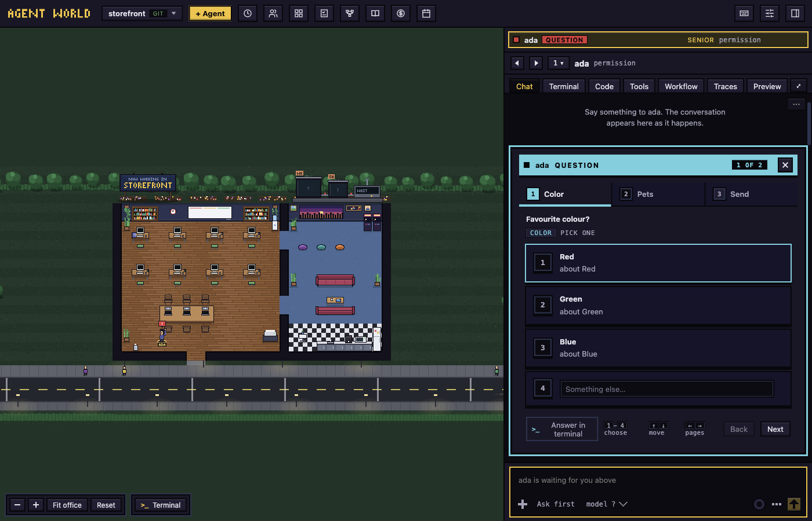

# Chat and dialogs

Talk to an agent in its **Chat** tab, read what it did, and answer when it asks you something.

## Send a message

1. Select an agent and open its **Chat** tab (see [The office](the-office.md#select-an-agent)).
2. Type, and press Enter. Shift+Enter starts a new line.

The reply appears with the agent's name, a **Copy** button and how long it worked. If the agent is asleep, click the **Wake** button instead (see [Wake an agent that is asleep](the-office.md#wake-an-agent-that-is-asleep)).

To find your way in a long conversation:

- **Show earlier** loads older messages. **Latest** brings you back to the end, and so does ⌘⌥↓ (Ctrl+Alt+↓), from the message box too.
- Cmd+F (Ctrl+F elsewhere) searches.
- **Conversation tools** (**⋯**, top right) has **Search**, **Save notes** and **Copy as Markdown**.
- Select words in a reply and click the button over them, such as **Ask ada**, then **Add**: the words join your message as a quote. **⇧⌘L** (Ctrl+Shift+L) does what that button does from the keyboard: in a reply it opens the same box; in a file, the terminal and the code editor it adds the selection to your message at once.

## The tool cards

Everything the agent does is a card. Commands, reads and searches in a row fold into one card ("Ran 4 commands"); click it to open it. An edit is a diff; click the file's name to open it (see [Code and preview](code-and-preview.md)).

The agent's calls to Agent World's own tools fold into a row for each area: **Workflow** ([Workflows](workflows.md)), **Todos** ([Todos](todos.md)), **Library** ([Library and playbook](library-and-playbook.md)) and **Notes**. Click a row to open a line for each call, then a line, then **Call details**. A line about one task has a `todo#N ↗` chip that opens that task on the Todos board. A button such as "2 commands running" above the box lists them with **Stop**.

## The message box

- **/** opens the agent's commands and skills. Tab or Enter completes. `/help` shows them all.
- **@** opens the files and folders of the agent's folder.
- **!** at the start of a message runs it as a shell command.
- Pictures and files: click **Attach** (the **+**), paste a picture, or drop files on the box. Click a picture's thumbnail, then **Edit**, to mark it up, then **Save**.
- Up Arrow brings back your earlier messages; Ctrl+R searches them.
- `/btw` and a question shows the answer in a **Side question** card with **Dismiss**.

## Permission modes

The mode button under the message box says how much the agent may do without asking:

- **Ask first** (grey): asks before edits and most commands.
- **Edit automatically** (gold): edits go through; commands still ask.
- **Plan** (cyan): reads and plans, and changes nothing until you approve the plan.
- **Auto** (orange): a classifier approves the safe actions.
- **Don't ask** (purple): only pre-approved tools run; the rest are denied.

To change it, click the button and pick one, or press Shift+Tab in the box. Some changes restart the agent on the same conversation, so they work only between turns.

## Queue, send now and stop

- You can type while the agent works. The message shows "Queued: sends when the agent finishes its current step".
- **Send now** (shown when the box has text) interrupts the agent and sends it.
- To stop the agent, click **Stop** or press Esc. This also denies any permission request it had open. If nothing has come after your last message, the message returns to the box.

## Rewind

To go back to before one of your messages, click **Rewind** under it (not shown while the agent works).

1. Claude Code asks what to restore, as a card in the chat. Answer it.
2. The message's words are back in the message box to edit and resend.

This is not the **Weekly Rewind** button in the top bar.

## Dialogs

When an agent needs you, a card with a red tag appears over the message box in the **Chat** tab. If you last chose the **Terminal** tab, a pop-up box opens instead.

To put a card away, click its **✕** or press Esc. The agent keeps waiting, and a line such as "ada is waiting for you · allow?" has **Show** to bring the card back.

**ALLOW?** The card says "Wants to use" and a tool, with what it will do. Click **Allow** or **Deny**. After 5 minutes a Claude Code agent's request falls back to Claude's own dialog in its terminal.

**PLAN** The card shows the plan. Click **Approve · auto-accept edits** or **Approve · review each edit**, type in "What should change?" and click **Keep planning**, or click **Reject plan**, which does what Esc does in the terminal.

**QUESTION** One page for each question, then a review page.

- Click an answer or press its number. "Something else…" takes your own words.
- **Next** turns the page and reads **Review** on the last. Check your answers, then click **Send answers**.
- **Cancel question** declines it, as Esc does in the terminal. ✕ only puts the card away.

**TRUST?** "Trust this workspace before the agent starts?" Click **Trust folder** to say yes or **Exit** to say no.

**ASKS YOU** The agent program's own menu, with a button for each option. **Cancel** appears only where the program's Esc does something. A new Claude Code's first questions come this way. A sign-in page that waits for a code has **Open terminal** instead.

**Answer in terminal** is at the foot of every card. It takes you to the agent's **Terminal** tab to answer the program's own dialog. From the chat it also makes **Terminal** the tab agents open on, until you click **Chat** again.

The model button, the ring (**Context and usage**, with **Compact**) and **More actions** (**Review**, **Clone**, **Hand off…**, **Remove agent** and more) sit under the box.

Next: [Code and preview](code-and-preview.md)
