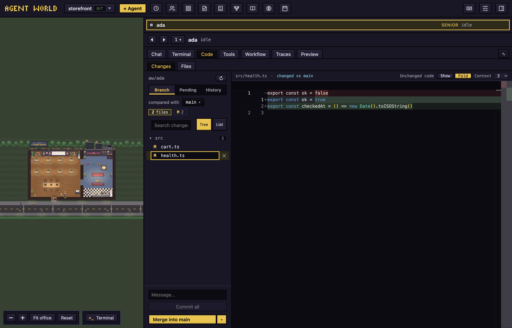

# Code and preview

Review what an agent changed, commit and land its branch, and look at its work running.

## Reach the tabs

Select an agent in the office. The tabs above its panel are **Chat**, **Terminal**, **Code**, **Tools**, **Library**, **Workflow** (only with Workflows on, see [Workflows](workflows.md)), **Traces** and **Preview**. A dot on **Preview** means a dev server of that agent is running. Clicking a file name in the chat opens an HTML page or PDF in **Preview**, a code file of the branch in **Code**, and anything else in a tab of its own with **Open with default app**.

## Review a branch

Open **Code**, then **Changes**. The list shows what the agent changed since its branch left the base branch: commits, uncommitted edits and new files. Click a file to see its diff. **↻** refreshes the list.

Above the diff, **Unchanged code** is **Fold** (the default) or **Show**. Folded, only the changes and a few lines around them are drawn, and a row such as "49 hidden lines" stands for the rest: click it, or drag its edge, to open more. **Context** (3, 5 or 10) is how many lines stay around each change. Both choices are kept for every file. Press ⌘⌥U (Ctrl+Alt+U) to switch between **Fold** and **Show**; **F1** in the diff offers **Show all hidden lines**. A new file has nothing to fold.

Switch the column between:

- **Branch**: everything compared with the base.
- **Uncommitted**: what is not committed yet (**Pending** in a narrow column).
- **History**: the branch's commits.

In **Branch**:

- To change the base, click the branch after **compared with** and pick another. This only changes the comparison and where merges and pull requests go.
- To narrow the list, use the **A**, **M** and **D** chips or **Search changed files…**. **Tree** and **List** change the layout.
- To discard a file's uncommitted changes, click its **✕**. It asks first.

In **Uncommitted**, files are grouped as **Staged**, **Changes** and **New files**, with **Stage all** or **Unstage all** on each group and **+**, **−** and **✕** on each row. In **History**, choose **Since main** or **All**, search by message, author or hash, and click a commit for its files and diffs.

## Commit

To commit everything, type a message in **Message…** and click **Commit all**. The agent's plan file (`.agent-world/plan.md`) is left out. To commit only some files, stage them in **Uncommitted**; the button then reads **Commit N staged**.

## Browse and edit files

**Files** lists the worktree's files. Click one to open it in a tab, edit it, and click **Save** (⌘S). Edits go straight into the agent's worktree. A Markdown file has **Preview** and **Source** to read it formatted or as text, and so does an HTML file, which shows as the page the file makes (as last saved, with its own stylesheet and pictures; press Save to see an edit); this is not the **Preview** tab. A PDF opens as a PDF with **Open in Preview**, not as text, and cannot be edited here.

## Send code to the agent

Select code in a diff or a file, then click **Ask** and the agent's name, or press ⌘L (Ctrl+L), or ⇧⌘L (Ctrl+Shift+L), the key that does this in every place that offers it. The code goes into that agent's message box as a chip. Chips waiting there show under the editor as **In the message**.

## Land a branch

- **Merge into main** (the base's name replaces `main`) merges the branch into your own checkout after a question. It refuses unless that checkout is on the base branch with nothing uncommitted. On a conflict it aborts and leaves the base unchanged.
- **Push & open PR**, in the **▾** menu **More ways to finish**, pushes to `origin` and opens a pull request. It needs `gh`, the GitHub command line tool.

To land through the plan and review gates, ask the agent to merge: git holds the merge until the gate is met or you **Set aside** what holds it (see [Workflows](workflows.md)). **Merge into main** applies none of the gates and merges as soon as you confirm.

An agent that works directly in your folder has no branch. **Code** then shows a note instead of **Changes** and **Files**.

## Preview

**Preview** shows web pages beside the chat:

- A dev server the agent started. Its page appears on its own when something answers at the address.
- A page file on your computer. HTML pages an agent opens in your browser also show here, unless you turned off **Open pages in the app preview** in Settings.
- A site on the internet.

To open something, type `5287` (for `localhost:5287`), `localhost:3000/app`, `example.com` or a path like `~/design/index.html` in the address bar, or pick from **Running now** and **Recent**. ⌘-click (Ctrl-click) a link in the chat to use your browser instead.

The first time a site on the internet opens, Preview asks **Open here** or **In my browser**. Pages there cannot reach your files or Agent World, use the camera, location or notifications, or download files.

The toolbar has **Back**, **Forward**, **Reload**, **Screen size** (**Desktop**, **Tablet**, **Mobile**), **Select element** (click something on the page to send it to the agent as words and a picture) and **Open in browser**.

## Terminal, Tools, Traces, History

- **Terminal** is the agent's own terminal; keys go straight to it. A selection offers **Add selection to message**.
- **Tools** lists MCP servers and plugins. Use **Add server**, **Remove**, **Enable**, **Disable** and **Uninstall** (click, then **Sure?**). It also holds **Project memory**, notes shared by every agent in the project.
- **Traces** lists messages agents sent each other. **Only name** narrows it to one agent.
- **History** in the top bar opens **Past conversations** for the open folder. Click one to continue it as a new agent.

Next: [Workflows](workflows.md)
