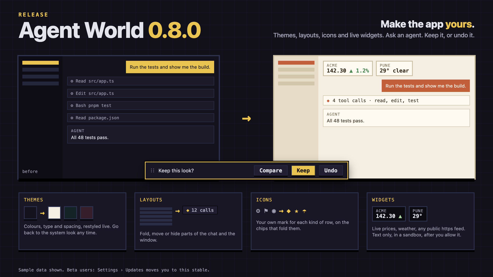

# Customize the look

Ask an agent to change how the app looks, then keep the change or undo it. Nothing sticks until you press **Keep**.

## Ask for a look

1. Open an agent's **Chat** tab (see [Chat and dialogs](chat-and-dialogs.md)).
2. Say what you want: colours, type and spacing, how the chat is laid out, a gauge above the message box.

The agent changes the look with layout rules and CSS. Its calls that do so are a group of their own in the chat, **Appearance**. What it made is on screen at once as a draft, and a bar over the window says who changed the look and why.

## Keep, Undo or compare

The bar has three controls:

- **Keep** makes the look yours. It is remembered the next time the app opens.
- **Undo** drops the draft and puts back the look you had.
- The eye button shows the look you had while you hold it, and the new one when you let go.

Drag the bar by its grip to move it anywhere in the window; it stays where you put it, and the arrow keys move it too. The message box, a request that waits for you, and the bar itself always stay on screen, whatever the CSS says.

The agent is told when you press Keep, Undo or restore, so it does not write back what you undid.

## Go back

The chat's **⋯** menu has two rows:

- **Restore system look** removes every change an agent made to the look of the app.
- **Previous look** brings back the look before the last one you kept.

## What a look can change

- Themes: colours, type and spacing, across the window.
- **Layouts:** rows of the chat can be folded into one chip, moved to the foot of the conversation, or hidden. A chip shows an icon, a count and a label, and opens to the rows it holds.
- **Icons:** each kind of row can have an icon of your choice.

CSS in a look may not load an address, so a look cannot pull in an image or a font from the network.

## Widgets

An agent can add a small widget to the chat: a gauge, a figure, a bar.

- A widget runs in a sandbox. It draws the numbers it is given and cannot reach the app or the network.
- It can show data from a public https address, such as a price or the weather. The app loads it, the widget gets text only, and nothing loads until you allow it: the bar says which site it will load from and has a **Load data** button.
- It can fill the chat panel behind the text, and be told how many keys were pressed and messages sent, never what was typed.
- It can show figures made from the agent's own telemetry, such as cache hit rate, time to first word or failed tool calls.
- If an agent wants a picture of the window, which shows your chats and todos, nothing is taken unless you press **Allow once**.
