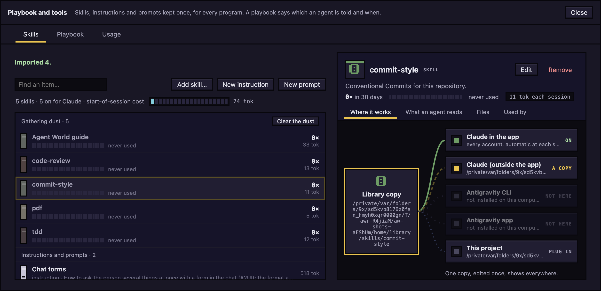
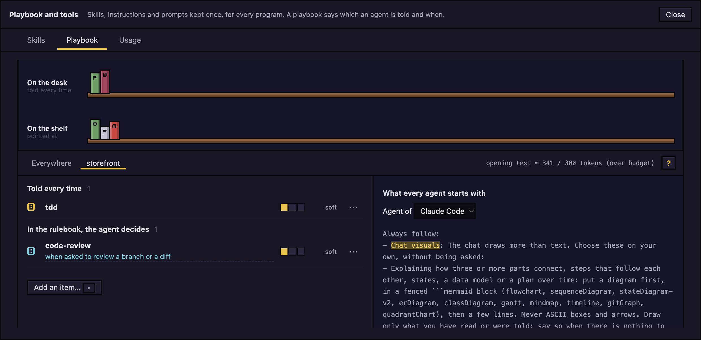

# Library and playbook

Keep skills, instructions and prompts once, and say which of them each agent is told, and when.

## What the library holds

One shared shelf for every project and both programs (Claude Code and `agy`). It holds **skills** (a folder with a `SKILL.md`), **instructions** and **prompts**. Each has a name, a one-line description and the text an agent reads. Items live in `~/.agent-world/library` by default.

The **playbook** says how an agent gets an item. An item does nothing until a playbook rule picks it.

## Open the library

Click **Playbook and tools** in the top bar. Its tabs are **Skills**, **MCP servers**, **Tools**, **Playbook** and **Usage**.

If the button says **Playbook and tools (off)**, open it and click **Open Settings → Features**, then turn on **Library and playbook**. Your items and playbooks are kept while it is off, and agents are told nothing from them.

## Put items in the library

On the **Skills** tab:

- To add skills you already have: click one in **Found, not in the library** and click **Add to library**, or click the **Import skills from device…** icon (a screen opens with a **Back to skills** button), tick the skills you want, or **Select all**, and click **Add N as links**. It lists only skills the library does not hold yet, each once. The **Select…** icon opens the same screen to remove skills in bulk: a link is only unlinked, a copy is deleted from the library. Nothing is copied: the library keeps a link to the skill's folder and a record of where it is, and nothing is written into that folder. The scan looks in `~/.claude/skills` and `~/.agents/skills` (links followed, so a skill is listed once), the `~/.gemini` skill folders, every project the app knows (its `.claude/skills` and `.agents/skills`) and the plugins of every account, including those Claude syncs into an account itself.
- To install new skills, click **Install skills…**, type a GitHub repository such as `owner/repo` (or its github.com link), click **Look inside**, tick the skills you want and click **Install**. The app runs the skills CLI in the background and shows what it says. The CLI reports installs to its maker, and the panel says so before you start. Skills land in `~/.agents/skills`, which Antigravity and others read, and the app adds each to the library as a link. If plain Claude Code cannot see a new skill yet, the panel says so and offers **Link into ~/.claude/skills**. It needs Node's `npx`; if it is missing, the panel says so.
- To write an instruction: click **New instruction**, fill in **Name**, **When to use it** and **Text an agent reads**, then click **Save** (or press ⌘↵; Esc cancels).
- To write a prompt: click **New prompt** and do the same.

Click an item to read it, **Edit** to change it, or **Remove** to delete it from the library. Use **Find an item…** to search. A skill's **Files** tab lists its other files with their size in tokens: **Open** opens one in the program your Mac uses for it, and **Show in Finder** shows the skill's folder. The line above the list says how many skills are on for Claude, and its meter shows about how many tokens their names and descriptions add to the start of every session.

The list is a panel for each place skills live in: **Global**, one for each project (its path beside its name), **Plugins** (read only, with their licence), **Kept in the library** (skills the library holds as copies) and **Found, not in the library** (dimmed). A row is the skill's name, one line about it (where it came from, or which folder it is in) and its size; the biggest come first, and the size beside each heading is the total. Sizes are measured in the background and kept. When an agent loads a skill while the window is open, its row blinks and shows +1. A skill that has a logo shows it as a small picture in front of its row, and larger beside its name in the reader: its plugin's own icon, or the picture of the GitHub owner it came from, fetched once when you add it. A skill with no logo keeps its coloured spine.

A skill's reader is one column: **Where it lives** (its real folder, with **Copy** and **Show in Finder**, where it came from and its licence, its project), **Where it works** and **Used in 30 days** (by project). Its **What an agent reads** and **Files** tabs are beside **Overview**.

Under it, **Remove from library** takes the library's link away and keeps the files. **Delete…** says what it would remove (the real folder with its size, every link that leads to it, and the playbook rules that name it), what that frees, and asks once; a project skill that git tracks asks a second time. A plugin's skills can only be removed, because Claude manages them. A copy the library holds, whose original is still there with every file of it, offers **Use the original, delete the copy**, which frees the copy.

## Choose where a skill works

Open a skill: **Where it works** lists a socket for each place. Click a socket to switch it. The skill's files stay where they are; the places get links, never copies.

- **Claude in the app**: on by default. Every Claude agent gets the skill when it starts, on every account the app has set up, and nothing is installed in an account's own folder. Switch it off to keep the skill in the library only. A skill a playbook rule names still reaches the agent, and a rule set to **Off** keeps one away.
- **Claude (outside the app)**, **Antigravity CLI**, **Antigravity app**, **This project (Claude Code)** (`.claude/skills`) and **This project (Antigravity)** (`.agents/skills`): click one marked **plug in** to link the skill into that program's skills folder; it then says **linked**. The link points at the library copy, so an edit shows everywhere. A place that is not installed here says **not here** and is greyed out. If a folder of the same name is already there, the socket says **a copy** and is left as it is. On **Claude (outside the app)** that copy is the one Claude uses, so the app does not add the library's as well.

A skill the agent's own Claude skills folder already has (linked or a copy) is not added again when it starts, so Claude does not list it twice. An account with a skills folder of its own still gets every skill.

Agents already running keep the skills they started with until they restart.

## Choose what agents are told

On the **Playbook** tab, the bookshelf at the top shows what is **On the desk** (told every time) and **On the shelf** (pointed at); click a book to open the item on the **Skills** tab. A notice appears there when the opening text is over budget. Below it:

1. Pick a scope: **Everywhere**, or the button named after the open project's folder. The project's rule wins over **Everywhere** for the same item.
2. Click **Add an item…** and click an item. It is added as **Pointed at**, soft.
3. To change how it is used, click **⋯** on its row and choose **Told every time**, **Pointed at**, **By a step** or **Off**. **Remove from playbook** takes it out.
4. For **Pointed at**, write the "When to use" sentence on the row: one plain sentence the agent can judge against its work, such as "failing tests".
5. Set the firmness with the three-step gauge: **soft**, **medium** or **hard**.

What the modes mean:

- **Told every time**: the item's words are in the agent's opening text.
- **Pointed at**: only the "when" line is in the opening text. The agent decides whether to read the item.
- **By a step**: a workflow step puts the item in.
- **Off**: never put in front of an agent.

A **soft** rule is only in the opening text. A **medium** or **hard** rule is also named in a short line sent now and then with your messages. **hard** also asks the agent to say, with `library_skip`, why it passed over a rule that could apply. Click **?** for the glossary.

The right half shows **What every agent starts with** for the program you pick under **Agent of**, plus **It can ask for**, **Reminder** and **Who gets this**. The header shows `opening text ≈ N / 300 tokens`, and a notice appears over 300.

An agent keeps the text it started with. After you change a playbook, click **Restart N agents** in the notice to apply it.

## The guide to Agent World

The Library holds one skill the app makes itself, **Agent World guide**, in the **Agent World** group of **Add an item…**. Its pages are these pages: the app copies the guide that ships with it, so what an agent reads and what you read on GitHub is the same text. The **Everywhere** playbook has a **Pointed at** rule for it, "the user asks how to do something in Agent World", so an agent reads the page first instead of answering from memory. Take the rule out and it stays out.

## Tools agents call

| Tool | What it does |
| --- | --- |
| `library_index` | Lists the items the playbook gives this agent. |
| `library_get` | Reads one item by id. |
| `library_search` | Searches those items by a few words. |
| `library_skip` | Says an item does not apply, with a reason. |

An agent can read only items in its playbook. Claude Code also gets the playbook's skills as skills it can load itself. For `agy`, connect it under **Settings** > **Message box** so its messages carry the line too.

## MCP servers and tools

The **MCP servers** tab lists the servers the programs' own files name, in panels by place like skills: the office's own, the ones Claude Code has everywhere, each project's, and agy's two lists. The app only reads those files and never changes them, and it shows the names of a server's variables, never what they hold. The switch at the end of a row turns a server off for the Claude agents the app runs: its tools are no longer offered to them, from their next start. A server whose own file says it is off shows as off, and turning it on clears that flag in the file. agy's lists, plugins and the office's own server are shown but not switched. Open a row to see where it lives, where else it is listed, which tools of it were seen in use, and in which projects.

Nothing is started when the tab opens. Press **Connect** on a row (or **Connect all**) and the app starts that server from its entry, asks it what it is and what it offers, shows its status on the row (connected with its tool count, failed with the reason, needs sign-in, timed out) and ends it. Open the row and its **Tools** tab lists what the server said about each tool: its description, its parameters, and whether it says the tool only reads or changes things. Those tools then also show on the **Tools** tab, so they can be told **Allow**, **Ask** or **Deny** before they are ever used. **Connect all** starts what is in your own files. A server listed in a project's `.mcp.json` comes with the project, so it is left out of **Connect all**, and **Connect** on it shows the whole command and asks first. A server that needs a sign-in is signed in to in Claude Code, not here.

The **Entry (JSON)** tab shows a server's entry as its own file has it, to change and save. Variables and headers show their names with the values masked: a value left masked is kept, and one typed over it is the new value. **Test connection** starts the entry as typed, before it is saved, so a wrong command or a missing variable shows up as a failure with its reason. **Add server…** writes a new entry into Claude Code's own file, the open project's `.mcp.json` or agy's CLI list. The old text of the file is kept beside it as `.aw-bak`.

The **Tools** tab lists Claude Code's own tools, agy's own tools, and the tools of each MCP server as they are seen in use (the app does not start a server to ask it). Each one can be told **Allow**, **Ask** or **Deny** for the agents the app runs: Allow runs without asking, Ask shows the permission band, Deny tells the agent no. Click the one that is on to go back to no rule, which leaves the choice to the agent's permission mode. agy's tools can be told **Deny** only, since the app can say no to an agent of agy's but cannot decide for it.

## See what the library did

- In the chat, notes under a message say what the library did, such as **Told at the start**, **Rulebook sent**, or an item read or passed over. Click a note to see the exact words.
- On an agent, the **Library** tab shows **What it was told** and **What it did**. It appears once the library has done something for that agent.

## Usage

The **Usage** tab has three tabs: **Skills**, **Playbook** and **MCP and tools**. The **MCP and tools** one counts calls by server and by tool over 30 days and lists the servers nobody called under **Gathering dust**, with **Turn off for Claude**. The top of the **Skills** tab shows the library's skills over the last 30 days, with the start-of-session cost meter. **Most used** ranks them with a bar each, the faces of the agents that used them, the accounts and when each was last used. A use is Claude loading the skill, or an agent reading it, counted once per turn however many of its files it reads then. Only use by agents in the app is counted. **Gathering dust** lists the rest with what each still costs at the start of every session: click **Turn off for Claude** to stop paying for it, **Remove** to delete it from the library, or **Clear the dust** to turn them all off for Claude. **Used in each project** shows each project's uses over every skill, with the skills used most there (the same counts are on a skill's **Overview**). **Who reached for what** shows each agent with the skills it used.

Below that, the tab judges each item on the prompts that looked related to it, not on every time the rulebook reminder named it (an agent is told to say nothing about a rule that does not apply, so most reminders can only end in silence). Under each name is how often it was reminded; the bars are **related** prompts, how often the item was **read** then (any time later in that session), and **said no**. The verdict is one of: most said no (the "when" is too wide: make it narrower), passed over in silence when it applies (make it firm or a step), fair, working, or too few to judge. Only whether a prompt looked related is kept, never the prompt. Use **Program** to switch between **Both programs**, **Claude** and **agy**. Click a row to see what agents said when they passed it over.

To fix a flagged row, click **Write a when** (**Write a narrower when** when most said no), **Make it firm** or **Make it a step**.

## What it costs

The opening text costs up to about 300 tokens once per session, and a message that points at an item about 60. **Settings** > **Features** has the estimates.

Next: [Todos](todos.md)
