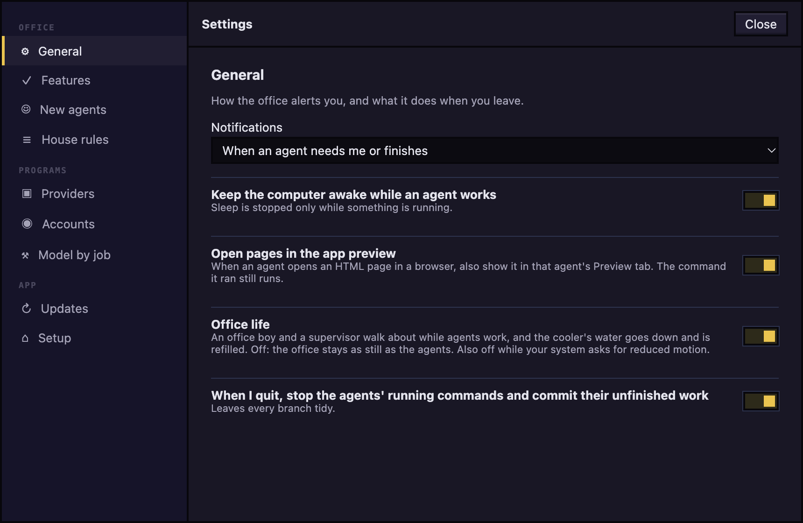

# Settings and updates

Where to change how Agent World alerts you, what new agents start with and where each program is, and how the app finds a newer version.

## Open Settings

Click **Settings** (the gear) in the top bar. The list on the left has three groups:

- **Office:** **General**, **Features**, **New agents**, **House rules**.
- **Programs:** **Providers**, **Accounts**, **Model by job**.
- **App:** **Message box**, **Updates**, **Setup**. **Message box** appears only when a ready program has a connection to make (Antigravity).

Each change is saved as you make it. Press **Close** when you are done. The preferences live in `~/.agent-world/preferences.json`.

## General

To choose when you are alerted, set **Notifications** to **When an agent needs me or finishes** (the starting choice), **Only when an agent needs me**, or **Never**. The switches below it keep the computer awake while an agent works, show pages an agent opens in its Preview tab, and, when you quit, stop the agents' running commands and commit their unfinished work. All three are on at first.

## Features

Features change what agents are told and add text to messages, so each switch shows what it costs.

- **Library and playbook:** on at first. See [Library and playbook](library-and-playbook.md).
- **Track every request as a todo:** off at first. See [Todos](todos.md).
- **Workflows:** off at first. It adds the Workflow tab and the **Workflows** button in the top bar. Turning it off while runs are open asks you to choose **Let them finish, then hide**, **Stop them now** or **Cancel**. See [Workflows](workflows.md).
- **Plan gate** and **Merge gate:** both on at first, and they apply only while Workflows is on.
- **Economy**, **Balanced** (the starting level) and **Max:** how much care a workflow takes. The line under the choice says what each does.

The library and todo switches take effect for agents started from now on and for each new message.

## New agents

This is what the hire form opens with; each hire can still change it. Set the **Model**, the **Permissions**, and **Work in my folder directly (no branch)**. Under **Subagents**, **Levels deep** (starting value 2) and **At once under one agent** (starting value 3) keep a chain of subagents from running away.

## House rules

Text typed under **Added to every agent** is added ahead of every agent's own instructions when it starts or wakes, for every program.

## Providers

Each program has a card saying whether it works here (`ready`, `not signed in` or `not found`). Type a path in **Location** only when the app cannot find the program on its own; it applies to agents started after you set it. **Re-scan** looks again.

## Accounts

For Claude Code, you can sign in more than one subscription and move agents between them without signing in again. Your own login is listed as **This computer** and is never changed.

To add an account: press **Add account**, type a name (only a label for you), press **Continue to sign in**, finish in the terminal and your browser, then press **I have signed in: check**.

Each account has **Sign in** (when it needs one), **Make default** and **Remove**. The default account is used for every agent you hire, and the hire form shows an **Account** choice once you have added one.

## Model by job

Choose the model used when a job is hired from each role. The hire form can still change it.

## Message box

To let an Antigravity agent message the others, press **Let agy (Antigravity) message other agents…**. The app shows the files it will write and the commands it will run, and changes nothing until you press **Connect**. **Disconnect** undoes it. Claude Code needs no connection.

## Updates

The installed app looks for a newer version about 15 seconds after it starts and then every six hours while it is open. A development build never looks.

To look now, press **Check now**; the line next to it says what was found. To use another source, type an **Update address** that starts with `http://` or `https://`; leave it empty to use the project's releases on GitHub. It is saved when you leave the field, and an address you clear takes effect after a restart.

When a newer version exists:

- **A Mac build that is not signed with an Apple Developer ID** (the build described in [Getting started](getting-started.md)) cannot replace itself. A chip with an arrow and the version number appears in the top bar, and **Open the release page** appears under **Check now**. Either opens the release page on GitHub; download the new version and install it as before.
- **A build that can install itself** (a Mac build signed with a Developer ID) downloads the update and says that it installs when you quit.

## Run setup again

Open **Setup** and press **Set up again** to repeat the first-run steps. See [Getting started](getting-started.md).

Next: [Troubleshooting](troubleshooting.md)
