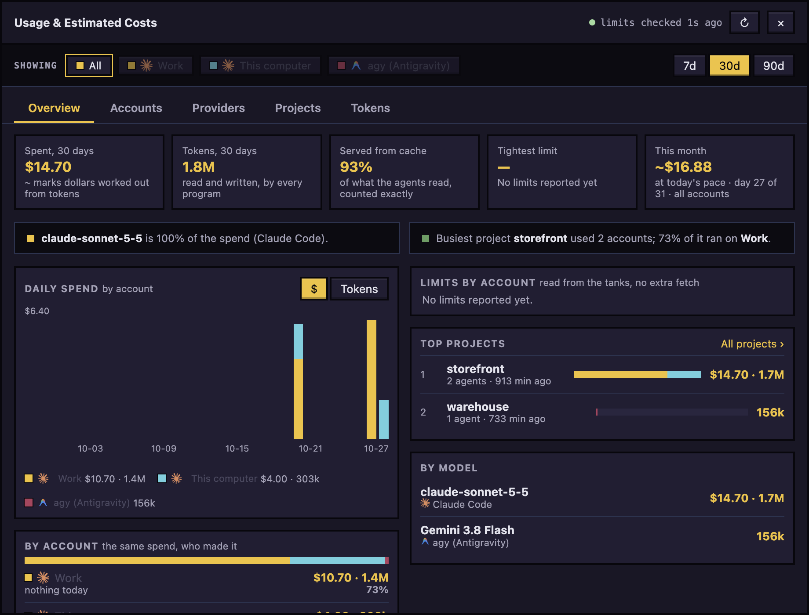

# The office

The office shows every agent of the open project as a character. Where it stands and what floats over its head say what it is doing. How it looks is in [DESIGN.md](../../DESIGN.md).

## Read the office

What each activity means, as the list shows it:

- **idle**: finished its turn, resting on a sofa. **waiting**: finished and waiting for you, in the lounge with a "?" bubble.
- **thinking**, **researching** (reading, searching), **implementing** (editing files), **running** (a shell command), **delegating** (handing work to a subagent): at its desk, each with its own bubble or effect. **compacting**: summarising the conversation to free up context.
- **permission**: it needs you. A red bubble with a blinking "!" and a waving arm.
- **blocked**: its turn ended in an error. It waits in the lounge.
- **asleep**: its program is not running. It is not in the office; only its row in the list says so.

An agent in the **Plan** mode works at the whiteboard.

Roles follow from what the agent does. A **senior** is a regular agent. It becomes a **boss**, with a crown, while its subagents work. A subagent is an **intern**: it arrives by car and sits beside its boss. Interns are not rows in the list. Click **Subagents** in the top bar to see them all.

## Select an agent

Click an agent's character or its row in the list.

- The character also opens its profile card: status, context used, cost, model, thinking level and mode. Close it with **×** or Esc; click the agent's name in the panel bar to bring it back.
- The panel on the right shows the agent's tabs. See [Chat and dialogs](chat-and-dialogs.md) and [Code and preview](code-and-preview.md).
- With an agent selected, the list folds into a bar with **Previous agent** and **Next agent** arrows and a button with the number of agents that opens the list. **others waiting** appears when another agent needs you.

To hand files to an agent, drop them on its character.

The number is red while another agent needs you and counts the others to look at; a tile in the list carries the same mark.

## Hire an agent

Click **+ Agent** in the top bar (disabled until a folder is open), fill in the form and click **Hire**. The form is described in [Getting started](getting-started.md#hire-another-agent). The new character walks in through the front door.

To continue an earlier conversation as a new agent, click **History** and pick it from **Past conversations**.

## Wake an agent that is asleep

1. Click its row in the list.
2. In its **Chat** tab, click the button that reads **Wake** and its name, for example **Wake ada**.

The agent comes back with its saved session. On the **Grid**, its tile says "asleep: open to wake".

## Answer a permission request from the world

1. Click the red tag in the agent's row, the row itself or its character.
2. In its **Chat** tab, read what it wants to use.
3. Click **Allow** or **Deny**.

The tag says what kind of request it is. Each kind is in [Dialogs](chat-and-dialogs.md#dialogs).

- A request from a subagent shows on the card of the agent above it.
- With notifications on in [Settings and updates](settings-and-updates.md) and the app in the background, a desktop notification names the request; clicking it selects the agent.
- For a Claude Code agent, a request nobody answers for 5 minutes falls back to Claude's own dialog in its terminal.

## The top bar

Except for **+ Agent**, the buttons are icons. Point at one to see its name.

- Project button: rest the pointer on it and a grid of your recent folders opens under it (a pixel picture each, how many agents work there, a red number when one waits for you, whether for a permission, a question or a workflow plan, approval, audit or push); one click switches. Click the button to keep the grid open until you click elsewhere. **Open another folder…** is at its foot, and with many projects it scrolls and gains a search box. The agent number beside the chat works the same way for agents. Both lists put what was active last first (what an agent did, or a message you sent it; opening it does not count), read when the grid opens and still while it is open. A small dot on either button means something is waiting elsewhere: red when another project (or agent) needs you, green when one finished while you were away, until you open it. On the agent number the dot is a count of the other agents to look at, and in the list each of them has the same mark on its tile (green with **Finished** under the name, or red); selecting an agent clears its mark.
- **History**, **Subagents**, and **Grid**, which shows every agent at once (each project keeps its own view and layout, also after you quit; a terminal cell opens a new shell after a restart). In **Conversations**, click an agent's name in its pane to open its profile card over the pane; **Esc**, the card's ×, or a click elsewhere puts it away, and another name moves it. The **>_** button in a pane's header turns it to the agent's own terminal (tagged **terminal**), and **chat** turns it back; each project keeps the choice for each pane, also after you switch projects or quit. A sleeping agent's terminal pane offers **Wake**.
- **Todos** ([Todos](todos.md)), **Workflows** ([Workflows](workflows.md)) and **Library** ([Library and playbook](library-and-playbook.md)).
- **Usage** (**Usage & Estimated Costs**, with a number when limits are nearly used up) and **Weekly Rewind**. Its **Tokens** tab shows where the tokens went: fresh input, what was read from the program's cache, what was written to it, and output, by provider, account, agent, project or model, and **Overview** says how much of what was read the cache served. Claude Code and agy report these exactly as they work (a count a program does not give shows as a dash, and agy does not report cache writes); history from before shows with no split. Everything stays on this computer. **Weekly Rewind** shows the week's tokens too, with their rise or fall from the week before as for cost (a week before that was counted the old way is compared without the cache), and its day chart switches between dollars and tokens.
- **Shortcuts**, **Settings**, and **Hide panel** or **Show panel**.

Over the office, **Zoom out**, **Zoom in**, **Fit office** and **Reset** change the view.

## Terminals

The **Terminal** button at the foot of the office (Ctrl+`) opens a drawer of your own shells under the office, one tab for each, each starting in the project's folder. **+** adds one, **×** closes one (a shell that is still running asks first), and **▾** hides the drawer: the shells keep running. Drag the drawer's top edge to resize it.

Each project has its own terminals. Switch project and you see only that project's; come back and they are as you left them, also after the window reloads.

## The usage tanks

The tanks on the lawn show how much is left of your usage limits: **5h** for the 5-hour limit and **wk** for the weekly one, a pair for each connected program.

The liquid is what is left. It turns amber once 70% is used and red once 90% is used, and a tank with no reading shows "?". Point at the tanks for **Your usage limits**. The **Usage** button shows the same numbers.

## Usage and the Weekly Rewind

**Usage** in the top bar opens **Usage & Estimated Costs**: what was spent and used in 7, 30 or 90 days, for all accounts or one, with tabs for **Overview**, **Accounts**, **Providers**, **Projects** and **Tokens**.

**Tokens** says where the tokens went, as one bar and a table: fresh input, what was read from the program's cache, what was written to it, and output, grouped by provider, account, agent, project or model. A dash is a figure the program does not report (agy does not report cache writes), and history from before tokens were counted this way shows hatched with no split.

**Weekly Rewind** shows one week: agent time, cost, tokens with their rise or fall from the week before (a week before that was counted the old way is compared without the cache), turns, the busiest hours, and a day chart that switches between dollars and tokens.

## Use it from the keyboard

Select an agent with Ctrl+Tab (Shift+Ctrl+Tab goes back), then Tab to **Allow**, **Deny** or **Wake**. Cmd+/ lists all shortcuts.

Hold Ctrl and press Tab again to see a bar of the agents in the order the **Agents** panel lists them (the latest first); each Tab steps on, Shift+Tab steps back, and letting go of Ctrl switches. Esc stays where you are, and a single tap switches at once with no bar. Shift+Cmd+[ and ] (Shift+Ctrl+[ and ] elsewhere) do the same for the projects, in the order of the project panel.

Cmd+Alt+1 to 9 (Ctrl+Alt+1 to 9 elsewhere) go to the first to ninth tab of the side panel, counting the tabs you see: Chat, Terminal, Code and so on.

To remove an agent, use **More actions**, then **Remove agent**. If its worktree has uncommitted changes, choose **Cancel (commit in terminal)**, **Remove, keep worktree** or **Discard changes**.

Next: [Chat and dialogs](chat-and-dialogs.md)
