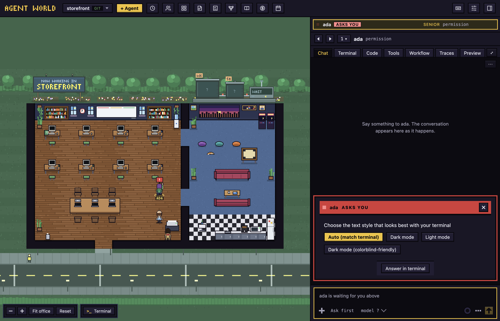

# Troubleshooting

Fixes for the problems you are most likely to meet on the first day: a blocked launch, setup and sign-in, a repository with no commits, a computer with no git, and an agent that is asleep.

## macOS blocks the first launch

The app is not signed with an Apple Developer ID, so macOS says it cannot check "Agent World" for malicious software. You approve it once. Use one of these:

- **macOS 15 (Sequoia) and later:** try to open the app once. Then go to **System Settings > Privacy & Security**, scroll down to the Security section, press **Open Anyway** next to "Agent World was blocked", and confirm with your password. Right-click > Open no longer works on these versions.
- **macOS 14 and earlier:** right-click the app in Applications, choose **Open**, then **Open** again.
- **Any version:** run this in a terminal, then open the app normally:

  ```
  xattr -dr com.apple.quarantine "/Applications/Agent World.app"
  ```

## Homebrew refuses the tap

Homebrew 6 and later loads nothing from a tap that is not its own until you trust it, once on each Mac. Two messages mean you have not yet:

- `Cask is unavailable … tap it explicitly`: the tap is not added. Run `brew tap hodkep/tap`.
- `Refusing to load cask hodkep/tap/agent-world from untrusted tap`: the tap is added but not trusted. Run `brew trust --cask hodkep/tap/agent-world`.

Then run `brew install --cask hodkep/tap/agent-world`. The same refusal stops `brew outdated` and `brew upgrade` on a Mac that installed the cask before Homebrew 6 and has not trusted it yet; the trust command fixes that too. The app's own update (the chip in the top bar) works either way.

## Setup will not let you continue

On the **Your agents** step, **Continue** stays disabled until at least one agent tool is ready.

- **Not installed:** press **Install Claude Code** (or **Install agy (Antigravity)**). The installer runs in a terminal in the step and the app looks again when it ends. If the tool is still not found, press **Try again**, or press **Copy** and run the command in a terminal yourself.
- **Installed somewhere the app does not look:** open **Settings**, choose **Providers**, type its path in **Location**, then press **Re-scan**.
- **Needs sign-in:** see the next section.
- **Connect agy (Antigravity) to the message box to continue:** press **Let agy (Antigravity) message other agents…** and then **Connect**. The app shows what it will write and run first.

If you have no agents and either setup was not finished or no agent tool is ready, setup opens again each time you start the app.

## Needs sign-in

**Needs sign-in** means the tool is installed but cannot be used yet. For Claude Code, either nobody is signed in or the first questions of a new Claude Code (text style, security notes) were never answered.

1. On the **Your agents** step, press **Open a terminal to sign in**.
2. Sign in in the terminal and answer the questions it asks. A page may open in your browser. The app never sees what you type.
3. Press **I have signed in: check again**. The tool should now say **Ready**.

Antigravity uses the same button.

## The first questions of a new Claude Code appear in the chat

A Claude Code that runs for the first time in a configuration folder asks a few questions before it works. Setup normally has you answer them, but they can also come up in an agent's terminal, for example for an account you added in Settings. The app shows each as a card in the agent's chat, marked **ASKS YOU**, with a button for each answer.

- To answer: press the button for your choice.
- To answer in the real terminal instead: press **Answer in terminal**, which opens the agent's Terminal tab.
- The login page that waits for a code can only be finished in the terminal, so its card has **Open terminal**. Finish in your browser and paste the code into the terminal.

The agent keeps waiting until the question is answered, even if you close the card.



## A project folder that is a git repository with no commits yet

A repository with nothing committed has no branch to start from, so the agent works in the folder itself, with no worktree and no `aw/` branch. The hire form says so: **Work in my folder directly (no branch)** is ticked and greyed out, and a note says "This repository has no commits yet, so the agent works in the folder itself."

Several agents in one folder can overwrite each other's files, so one agent at a time is the safe way to work here. To give each agent its own branch, make a first commit in the folder:

```
git add -A
git commit -m "First commit"
```

After that, new agents get a branch of their own. An agent that was already hired keeps working in the folder.

## A computer with no git

You do not need to install git. Agent World carries its own and uses it when the computer has no working git of its own. The app chooses its git when it starts. The **Git** row on the **Your agents** step shows which one is used.

A new Mac has a file at `/usr/bin/git` that is not git: it opens Apple's installer when something runs it. The app never runs it to find out, and counts it only when Apple's command line tools are installed, so Agent World does not bring up Apple's installer.

If the **Git** row says **Not found**, you are running a build made without the bundled git, for example one built from source. Install git with `xcode-select --install`, then start the app again.

## An agent is asleep

When you restart the app, every agent is asleep. Its chat says "<name> is asleep." with a **Wake <name>** button in place of the message box. Press it to resume the agent's session.

Next: [Getting started](getting-started.md)
