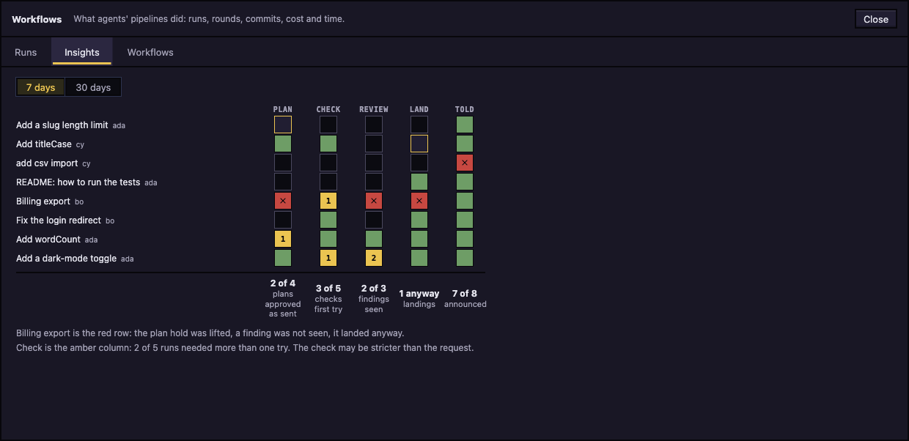

# Workflows

A pipeline an agent follows for each task (plan, build, checks, review, land), with gates that stop for you and a record of how each run went.

## Turn workflows on

Workflows is off until you turn it on. Open **Settings** (the gear in the top bar), then **Features**. The first-run setup has the same **Workflows** switch.

- **Workflows**: the main switch. On, it adds the **Workflow** tab to each agent and a **Workflows** button to the top bar.
- **Plan gate**: on by default. An agent that starts a task writes its plan first and waits for your approval before it edits files.
- **Merge gate**: on by default. Landing waits until the plan was approved and the review's findings were seen.
- The dial (**Economy**, **Balanced**, **Max**): how much care each task takes. **Balanced** is the default. See [The three dials](#the-three-dials).

Under the dial, a table estimates what each level adds to a task, in tokens.

To turn Workflows off with runs still open, Settings asks: **Let them finish, then hide**, **Stop them now** or **Cancel**. Until the open runs end, no new run starts and the **Workflows** button stays, marked as winding down.

## What an agent does with a workflow

A workflow is an ordered list of steps. Each project has a default workflow, **Standard** unless you pick another (see [The workflow list](#the-workflow-list)). Standard has four steps: **Plan**, **Build**, **Audit** and **Land**. The agent may pick another of the project's workflows when the work clearly fits it.

For one task the agent:

1. Tells the office it has started a task. That opens a run.
2. Writes a plan to `.agent-world/plan.md` in its worktree and hands it in. The plan starts with a short read-back: the goal, assumptions each marked given or guessed, what is out of scope, and open questions. The app checks that block and sends every problem back to the agent at once.
3. Waits for you to approve the plan. See [Approve a plan](#approve-a-plan).
4. Builds, reports each step it does, and says when it is done.
5. Has its **check** steps run by the app, if the workflow has any. See [Checks](#checks).
6. Has its branch reviewed against the plan, when the workflow has a review step and the dial is not **Economy**.
7. Lands the branch when you ask it to. See [Land a branch](#land-a-branch).

A request after a task finished can become a second round of the same run. An agent that commits without ever announcing a task still gets a run: the app starts one from the commit and marks it **from a commit**. Only commits made after you turned Workflows on count, and such a run has no workflow, so no plan hold and no track.

## What the app enforces and what it only asks

Announcing a task, handing in a plan, reporting steps and saying done are asked of the agent in its opening text and the replies of the office's tools; the app cannot make a program do them. These parts the app does itself:

| Rule | Held by |
| --- | --- |
| No edits until the plan is approved (the Edit, Write, MultiEdit and NotebookEdit tools) | A hook for Claude agents; for agy agents, the plugin Agent World installs for agy, when it is installed and current. A change made by a shell command (`sed -i`) is not caught at the edit but at the commit. |
| No commit until the plan is approved | Git itself, for every program. A commit made with `--no-verify` is held too. |
| A merge into the base branch while the gate holds it | Git itself, for every program: see [Land a branch](#land-a-branch). |
| Checks | The app runs them and reads the exit code. |
| The review of the branch | The app asks a model in a separate call. |
| Finish and landing | The app refuses until the gate is met, unless you choose **Land anyway**. |

Limits:

- Git is held through environment variables the app gives each agent it starts. An agent that unsets them, or runs git with its own `core.hooksPath`, gets past the commit and merge holds. Finish still asks when you use it.
- An unreachable office lets a commit through.
- Only a task's first round is held for its plan. A follow-up round is not.
- With **Plan gate** off, nothing is held for a plan. At **Economy** an agent may skip the plan for a change that fits one sentence, and with no plan submitted its edits and its landing are not held for one. A plan that was submitted is still held.
- The **Merge into main** button in the Code tab does not apply any of this. It merges when you confirm. Use **Finish this branch** to have the plan and review checked (see [Code and preview](code-and-preview.md)).

## Follow a run: the track

While an agent has an open run, a track sits above its chat: the run's steps as stations on a rail, with the agent's figure at the one it has reached. Each station is **met**, **met after trouble**, **failed**, **here now**, **not yet** or **not asked**. A number on a station counts how often a check failed or the plan was sent back. Hover a station for its state.

Beside the track, a line says what the run waits for:

- **needs your approval**: a plan or a step that needs you.
- **its commands need your approval**: a check's commands (see [Checks](#checks)).
- **out of tries: your call**: a check failed every try.
- **plan sent back: being revised**: the agent is reworking a plan you sent back.
- **ready to land: ask the agent**: the work is done; asking the agent to merge it lands it.

The track disappears once the run landed, was stopped, or has every step met. The number on the **Workflows** button counts plans, steps and check panels waiting for you.

## Approve a plan

When an agent hands in a plan, a **Plan gate** panel opens in its chat: **Check what name understood before the build starts**. It shows the **Goal**, each assumption as **Given** or **Guessed**, what is **Out of scope**, and the **Open** questions. Answer each open question first; unanswered ones block approval.

- **Approve plan** lets the agent edit.
- **Request changes**, a note, then **Send back**: your note and answers are typed into the agent's prompt and it revises the plan.
- **Let name edit without approval** lifts the hold without approving. The run records that the hold was lifted.

At the **Max** dial a second model also reads your request against the plan and adds what the request left open, marked **From check**. These block approval like any open question. A failed check never blocks the plan.

## Checks

A workflow can have **check** steps: a command the app runs in the agent's worktree, on your computer, with a 5 minute limit. The Standard workflow has none.

- A project's workflow file comes from the repository, so its commands do not run unseen. A panel in the chat lists them: **Approve and run** or **Don't run**. The approval covers that exact version of the file. After an edit the panel is headed **File changed**, shows what was added and removed, and asks again (**Approve this version**).
- When a check fails, the app types the command and the end of its output into the agent's prompt, up to two retries unless the step says otherwise.
- After that a **Check failed** panel offers **Run again** and **Skip this check**.
- A check that must pass holds landing until it passes or you skip it.
- A step marked **your approval** waits in the chat for **Approve** or **Send back**, and holds landing until approved.

## Land a branch

To land a branch, ask the agent to merge it. If the gate holds the merge, git itself refuses it, and the agent is told to tell you what holds it and ask. A band appears under the run track in that agent's chat, and the track gets a **Land held** marker. Any move of the base branch by the agent's git counts (a merge, a fast-forward, a ref update), from the project folder or from its own worktree.

What can hold it, in the words the band uses:

- **No plan was approved for this task.** / **The plan is still waiting for your approval.** / **You asked for changes to the plan and no new plan was approved.**
- **N audit findings have not been seen.**
- **The review has not run for this branch yet.** / **The review is still running.** A review that has not run starts at the first held try, so there are findings to read.
- A check that has not passed, or a step that has not been approved, named in quotes.

The two review lines hold a merge the agent makes. Finish, in contrast, starts the review when it opens and shows it as a note.

The band is headed **Merge held** with `branch → base`. It shows what holds the merge and the review's findings, each marked out of scope, goal not met or guess may be wrong. Release it one of two ways:

- Tick each finding as seen. When nothing holds the merge any more, the band says so and the agent's next try goes through with no further word from you. Ask the agent to merge again.
- **Land anyway** lets the branch as it is now land, once, on the agent's next try. If the agent adds commits, it is held again.

**Not yet** puts the band away. The marker stays and reads **Land held · not yet**; click it to bring the band back. If the agent tries again and is held again, the band returns too. The agent cannot press either button.

When a merge lands under git's hold, the app logs it, as landed or as landed anyway with what was holding it.

The **Finish this branch** dialog (see [Code and preview](code-and-preview.md)) is a shortcut that shows the same rows and has its own **Land anyway** button.

The review is a separate model call under the agent's account, made once for each state of the branch. It reads the plan's read-back against the branch's committed changes, and lists what it did not expect: out of scope, goal not met, or a guess that may be wrong. A very large change is cut at a file boundary, and Finish says so. A review that fails says why and never holds landing. At **Economy** there is no review.

Checks and steps that need your approval hold landing even when **Merge gate** is off. Only the plan and review rules switch off with it.

## The Workflow tab

**Workflow** in an agent's tab strip (a dot on it means an open run) shows where that agent's latest run stands: the track with the agent on its station, and the same **Land held** marker when git holds a merge. Under it, **This week** has a tile for each run, by the day it began. A tile says whether the run met every gate, met its gates with trouble, missed or overrode one, or is waiting. Click a tile, or **All of name's runs in Workflows**, to open the Workflows window on it. A line under the tiles says how many finished runs met every gate this week, and what they cost.

## The Workflows window

Click **Workflows** in the top bar. The window has three tabs.

### Runs

**7 days** or **30 days** sets how far back it looks. Two charts sit over a ledger.

- **Workflows invoked**: a bar for each workflow and a small column for each day. Runs the app started from a commit are counted apart, as "from a commit".
- **Stages followed**: a bar each for **Plan**, **Checks**, **Review** and **Landing**, split into first time, after trouble and not followed, with "3 of 4" counted over the runs that reached that stage.

The ledger groups runs by what to do about them:

- **Needs you**: runs held at a gate, such as a plan or commands to approve, or a finished run waiting to be landed.
- **Still open**: runs still going.
- **Landed with trouble**: finished runs that went ahead past a gate, for example by lifting the plan hold, landing anyway with a finding unseen, or skipping a check.
- **Landed clean**: finished runs that met their gates. A retried check or a plan sent back still counts as clean; the group says how many needed a second try.
- **Stopped**: runs that were stopped.

Each row has columns: **Wall time**, **You waited**, **Checks**, **Review**, **Commits** and **Cost**. The column headings carry the totals for the days shown (for example the median wall time, and how many checks passed first try). Click a row to open it in place: its rounds, commits, and a line for each thing that happened, with how long after the start.

### Insights

A tile for each gate of each run, newest run first: **Plan**, **Check**, **Review**, **Land** and **Told** (whether the agent announced the task rather than the app starting a run from a commit). Green is met first time, amber is met after trouble with the count in it, red with a cross is missed or overridden, an empty tile is not asked, and a brass ring is waiting. Under each column is its number, such as plans approved as sent or checks passed first try. Two lines of words point at what stands out: the red row (the run with most missed gates, and why) and the amber column (a gate that often needed more than one try, and what that may mean). It shows up to 12 runs.

### The workflow list

The **Workflows** tab is a list of the project's workflows with the chosen one's steps beside it. Walk the list with the arrow keys, Home and End.

- Each entry is marked **Built in**, **Everything** (kept for all projects) or **This project**, and **default** for the project's default. A file that cannot be read is marked **Has problems** and lists what is wrong. A workflow in the project wins over one kept for everything with the same id.
- The detail shows when the workflow fits, its runs this week and its steps. A step can carry a **you approve** tag or **must pass**, a command, and skills it names. A skill the library does not have is flagged, and agents are told to skip it.
- **Make default for** and the project's name makes it the one agents use. **Copy to** the project and **Copy for everything** make a copy. **Delete** asks first and is not offered for the built-in one.

A workflow is a JSON file: `.agent-world/workflows/` in the repository for **This project**, and the app's own `workflows` folder for **Everything**. A workflow has at most 12 steps, each a **plan**, **build**, **check**, **audit** (the review), **your approval** or **land** step. In the file the kinds are `plan`, `work`, `check`, `audit`, `approve` and `merge`. A plan or land step that says nothing about its gate follows the **Plan gate** or **Merge gate** switch.

#### Make a workflow from a sentence

You need a project open. Type what you want in **Describe a workflow to the builder**, for example "every change to billing needs a security review and a second approval", then click **Start with the builder**. **Open the builder** starts it with nothing typed. **Edit with the builder** on a workflow starts it on that workflow.

The builder is an agent named `builder`, made for the project the first time you use it. It works in read-only plan mode, and it can read the project's workflows and propose one. It cannot save anything. The window splits: its chat on the left, its draft on the right. A new draft shows its steps. A change to a saved workflow shows **What changes** against the saved version. The draft lists any commands it would run on your computer.

You save with a button: **Save to project** or **Save for everything** for a new one, **Replace** or **Save as a new workflow** for an existing one, or **Discard**. Saving approves exactly the commands the file holds, so you are not asked again when a run reaches them. If the saved workflow changed after the draft was made, saving is off until the builder looks again. **← All workflows** goes back to the list.

## The three dials

The dial in **Settings > Features** sets how much the app does per task. It changes the app's own checks and what agents are told. It does not change the model an agent runs on.

| Dial | Plan | Review of the branch | Intent check |
| --- | --- | --- | --- |
| **Economy** | Only when the task is more than one sentence | None | None |
| **Balanced** | Every time | A small model | None |
| **Max** | Every time | A larger model | A second model reads your request against the plan |

At **Economy** the plan is the agent's own call: it is asked to skip the plan for a change that fits one sentence, and when it does, nothing is held for a missing plan. The review and the intent check are separate model calls under the agent's account; they use your usage but add nothing to the agent's own context.

Next: [Library and playbook](library-and-playbook.md)
