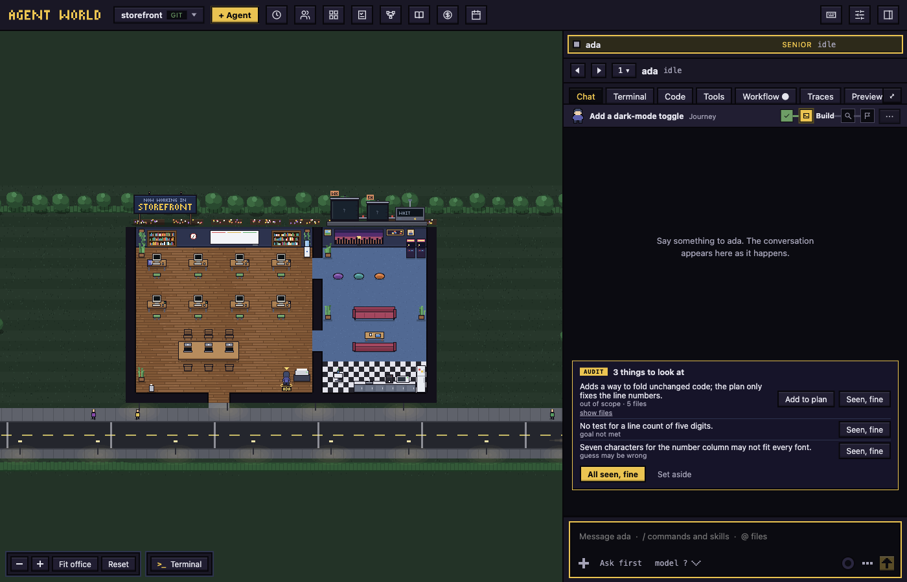

# Workflows

A pipeline an agent follows for each task: plan, build, checks, review, pull request.

## Turn workflows on

Off by default: **Settings**, then **Features**.

- **Workflows** adds a **Workflow** tab to each agent and a top bar button.
- **Plan gate** (on by default): an agent waits for your approval of its plan before it edits.
- **Merge gate** (on by default): the pull request waits for an approved plan and seen findings.
- The dial sets how much care each task takes: [The three dials](#the-three-dials).

## What an agent does with a workflow

The default is **Standard** (**Plan**, **Build**, **Audit**, **Pull request**), or your pick for the project. For one task the agent:

1. Tells the office it began a task, which opens a run. Each turn without one adds a reminder.
2. Writes a plan to `.agent-world/plan.md` (goal, assumptions, out of scope, questions).
3. Waits for your approval, then builds.
4. Has any **check** steps run, and its branch reviewed against the plan (not at **Economy**).
5. Pushes the branch for a pull request when you ask.

A commit with no announced task gets a run marked **from a commit**, in the **Not announced** group, with no workflow, plan hold or track. It joins the agent's todo.

## Enforced and only asked

Announcing a task, handing in a plan, reporting steps and saying done are only asked. The app holds:

- Edits until the plan is approved: by a hook for Claude agents, by a plugin for agy agents. A shell command such as `sed -i` is caught at the commit instead.
- Commits until the plan is approved, and, while the gate holds it, a push of its branch (a **Pull request** step) or a merge into the base branch (a **Land** step): by git, for every program.
- Checks and the review: the app runs them.
- **The pull request**: git holds the push unless the gate is met or you **Set aside** what holds it. A push that goes through ends the run.

The audit starts by itself, once, when the agent's steps before it have passed. It is one model call, so a run that commits again later is **not** audited again by itself; if git then holds the merge, its card has **Run the audit**. What waits for you shows as a pill beside the agent (PLAN, APPROVE, CHECK?, AUDIT, LAND), in the agent switcher and under "others waiting", and the agent raises a hand in the office.

Findings to look at show as a card at the end of the agent's chat. The reviewer reports one row per cause, with every file it covers (**show files**). Each row has **Seen, fine**, and out-of-scope work also has **Add to plan**: it stays in scope for later audits and counts as seen. **All seen, fine** answers every row, and **Set aside** the whole audit. Nothing sits above the message box and nothing opens by itself. **Set aside** records the audit as not followed (the track and the ledger say so), and nothing it found holds the merge; a line in the chat has **Undo**.

Limits:

- An agent that unsets git's environment variables, sets its own `core.hooksPath` or pushes with `--no-verify` gets past the git holds; a skipped push is still recorded as pushed anyway.
- Only a task's first round is held for its plan, and not with **Plan gate** off.
- The **Merge into main** button in the Code tab applies no gate. To land through the gate, ask the agent to merge.

## Follow a run: the track

While a run is open, a track sits above the agent's chat: its steps as stations, with the agent's figure on the one it has reached. A station is **met**, **met after trouble** (with a retry count), **failed**, **here now**, **not yet** or **not asked**. The agent's **Workflow** tab shows it with a tile for each run this week.

## Approve a plan, checks and steps

- A **Plan gate** panel opens in the chat. Answer the open questions (a plan with none says the agent asked no questions), click **＋ Add a note for name** for a note that goes with the approval, then **Approve plan**, or **Request changes** and **Send back**. **Let name edit without approval** lifts the hold.
- A **check** step is a command the app runs in the agent's worktree, with a 5 minute limit. A project's commands need **Approve and run** (or **Don't run**) first, and again after the file changes. A failing check goes back to the agent, twice by default, then **Run again** or **Skip this check**.
- A **your approval** step waits for **Approve** or **Send back**.

## Open the pull request

Ask the agent to push the branch. If the gate holds it, git refuses, the agent tells you why, a **Push held** marker is on the run track, and a card at the end of the chat lists what holds it, such as an unapproved plan or **N audit findings have not been seen**. Then either:

- Click **All seen, fine** for the findings, then ask the agent to push again.
- Click **Set aside**. It lifts the hold, so the branch goes through once, on the agent's next try, and records the audit as not followed.

A branch that shares no history with its base (the base was rewritten) cannot be landed: a red line at the end of the chat says to reset it onto the base. A failed review never holds it. Checks and steps that need you hold it even with **Merge gate** off.

## The Workflows window

- **Runs**: for **7 days** or **30 days**, two charts (**Workflows invoked**, **Stages followed**) over a ledger grouped as **Needs you**, **Still open**, **Landed with trouble**, **Landed clean**, **Stopped** and **Not announced**.
- **Insights**: a tile for each gate of each run.
- **Workflows**: the project's workflows, the chosen one's steps and its **History**: what was saved to it through the builder.

## Make or change a workflow

1. Type a sentence in **Describe a workflow to the builder** and click **Start with the builder**, or click **Open the builder** to start empty. To change a saved one, click **Edit with the builder**: a fresh chat starts with it as the draft.
2. The builder only proposes. Talk to it, or edit the draft: names, briefs, skills, a check's command, **Tries** and stop, and steps (**▲ ▼**, **✕**, **＋ Add step**). **You edited N things** counts your changes; **Undo edits** goes back to the proposal.
3. Saving waits while the draft has a problem. Click **Save to** the project, or **Save for everything**; saving approves exactly the commands the draft lists.

## A run and its todo

A run begun while its agent is on a [todo](todos.md) belongs to that task:

- The **Runs** ledger shows a `todo#N` chip. Click it to open the task.
- The task's **Workflow run** section says how the run stands, in the ledger's own words (such as **still open**). Click it to open the run.
- Finishing the run finishes the task, if the agent has not.

## The three dials

- **Economy**: the plan may be skipped for a one-sentence change; no review.
- **Balanced** (default): a plan every time; a small model reviews the branch.
- **Max**: also a larger reviewer, and a check of your request against the plan.

Next: [Library and playbook](library-and-playbook.md)
