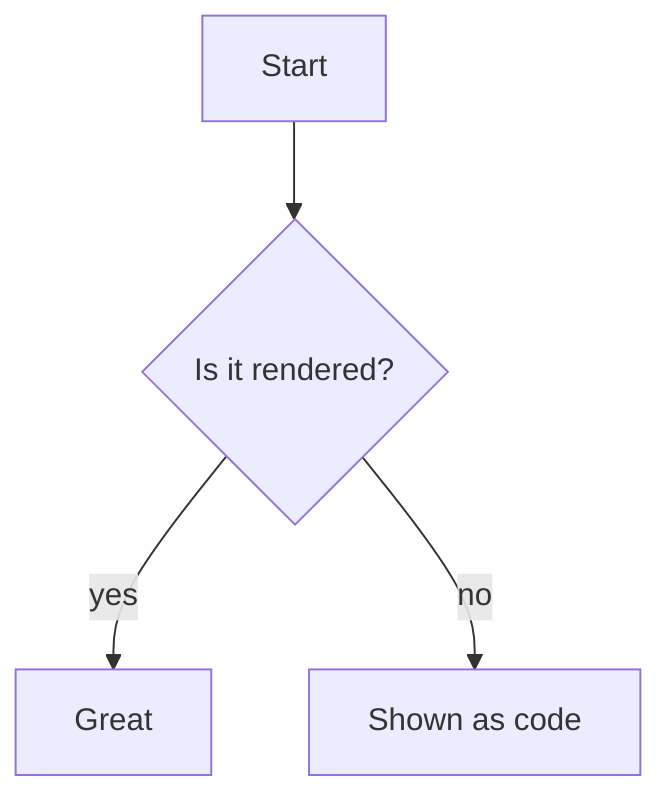

# Markdown stress test

Paste this whole file to an agent ("repeat the following message back exactly, inside no code block") or load it with `FAKE_SAY_FILE`. Section 9 holds syntax beyond plain GFM: footnotes, maths, diagrams, alerts, definition lists, emoji shortcodes, highlight, super/subscript.

## 1. Headings

# H1 heading
## H2 heading
### H3 heading
#### H4 heading
##### H5 heading
###### H6 heading

Setext heading one
==================

Setext heading two
------------------

## 2. Emphasis and inline

*italic* _italic_ **bold** __bold__ ***bold italic*** ~~strikethrough~~ `inline code` **bold with `code` inside** *italic with **nested bold***

Escapes: \*not italic\* \`not code\` \# not a heading \[not a link\](nope) 1\. not a list

Hard break with two trailing spaces:  
second line, and a backslash break:\
third line.

A very long unbroken string: AAAAAAAAAAAAAAAAAAAAAAAAAAAAAAAAAAAAAAAAAAAAAAAAAAAAAAAAAAAAAAAAAAAAAAAAAAAAAAAAAAAAAAAAAAAAAAAAAAAAAAAAAAAAAAAAAAAAAAAAAAAAAAAAAAAAAAAAAAAAAAAAAAAAAAAAAAA

Unicode: café, naïve, 日本語のテキスト, 한국어, العربية, עברית, emoji 🚀🎉👩‍💻, combining e + ◌́ = é

## 3. Lists

- Unordered item one
- Item two
  - Nested level two
    - Nested level three
      - Nested level four
- Item three with a paragraph

  A second paragraph inside the item.

  ```ts
  const insideList = true
  ```

1. Ordered one
2. Ordered two
   1. Nested ordered
   2. Another
      - Mixed bullet inside ordered
3. Ordered three

10. Starts at ten
11. Eleven

- [x] Task done
- [ ] Task open
- [ ] Task with **bold** and `code`
  - [x] Nested task

## 4. Tables

| Left | Center | Right |
| :--- | :----: | ----: |
| a | b | c |
| `code \| with pipe` | **bold** | 12.50 |
| a long cell that goes on and on and on and on and on and on and on and on and on | x | y |

| Very | wide | table | with | many | columns | that | should | scroll | or | wrap | gracefully | without | breaking | the | panel |
| - | - | - | - | - | - | - | - | - | - | - | - | - | - | - | - |
| 1 | 2 | 3 | 4 | 5 | 6 | 7 | 8 | 9 | 10 | 11 | 12 | 13 | 14 | 15 | 16 |

## 5. Quotes

> A quote
>
> > A nested quote
> > > And a third level
>
> - a list in a quote
> - another
>
> ```python
> print("code in a quote")
> ```

## 6. Code

```ts
interface Agent { id: string; name: string }
export async function hire(name: string): Promise<Agent> {
  return { id: crypto.randomUUID(), name }
}
```

```python
def fib(n: int) -> int:
    return n if n < 2 else fib(n - 1) + fib(n - 2)
```

```json
{ "name": "agent-world", "private": true, "nested": { "list": [1, 2, 3], "ok": true } }
```

```diff
- const old = 1
+ const next = 2
```

```bash
pnpm install && pnpm dev
```

```sql
SELECT name, COUNT(*) FROM agents GROUP BY name HAVING COUNT(*) > 1;
```

```yaml
services:
  app:
    image: node:22
    ports: ["5173:5173"]
```

```
a fence with no language
    keeps   its   spacing
```

```madeuplang
an unknown language
```

````md
A four-backtick fence holding a three-backtick fence:

```js
console.log('inner')
```
````

    An indented code block (four spaces)
    second line

## 7. Inline HTML

<details>
<summary>Click to expand (details/summary)</summary>

Hidden **markdown** inside details, with a list:

- one
- two

</details>

Keys: <kbd>Cmd</kbd> + <kbd>K</kbd>. Water is H<sub>2</sub>O, E = mc<sup>2</sup>. <mark>Highlighted</mark>. <abbr title="HyperText Markup Language">HTML</abbr>. <u>underline</u>. <del>deleted</del> <ins>inserted</ins>.

<div align="center">A centered div with <b>bold</b></div>

<!-- an HTML comment that should not show -->

<script>alert('this must never run')</script>

<a href="javascript:alert(1)">a javascript: link (must be stripped)</a>

## 8. Links and images

[Inline link](https://example.com) · [With title](https://example.com "A title") · [Reference link][ref] · <https://example.com/autolink> · bare https://example.com/bare-url · <mailto:someone@example.com> · [Anchor to section 3](#3-lists) · [Relative](./README.md)

[ref]: https://example.com/reference


---

***

___

## 9. Extended syntax (beyond plain GFM)

Footnote reference[^1].

[^1]: The footnote text.

Inline math: $E = mc^2$ and block math:

$$
\int_0^\infty e^{-x^2}\,dx = \frac{\sqrt\pi}{2}
$$



> [!NOTE]
> A GitHub-style alert.

> [!WARNING]
> Another one.

Term
: Definition of the term (definition list)

Emoji shortcodes: :tada: :rocket: :+1:

Highlight with ==equals signs==, H~2~O as subscript and x^2^ as superscript (a single tilde is subscript; strikethrough is ~~two~~).

These need a target to point at, so they stay plain text: [[wiki-link]], #issue-123 and @mention.

## 10. The end

Last paragraph, to check the bottom of the message sits clear of the box.
