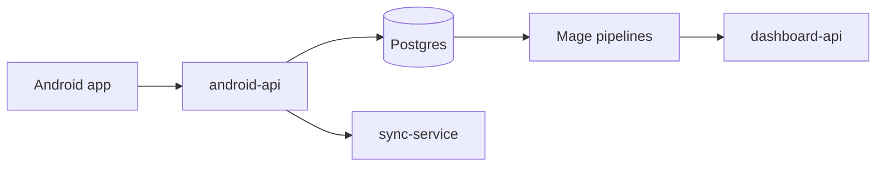

Here is how the pieces fit, and one question before I start.



```a2ui
[
  {"version":"v0.9","createSurface":{"surfaceId":"plan","catalogId":"basic"}},
  {"version":"v0.9","updateComponents":{"surfaceId":"plan","components":[
    {"id":"root","component":"Card","child":"col"},
    {"id":"col","component":"Column","children":["title","which","rows","dry","go"]},
    {"id":"title","component":"Text","variant":"h3","text":"Which pipeline first?"},
    {"id":"which","component":"ChoicePicker","label":"Pipeline","variant":"mutuallyExclusive","options":[{"label":"hourly","value":"hourly"},{"label":"daily","value":"daily"}],"value":{"path":"/pipeline"}},
    {"id":"rows","component":"Slider","label":"Batch size","min":100,"max":5000,"value":{"path":"/batch"}},
    {"id":"dry","component":"CheckBox","label":"Dry run only","value":{"path":"/dry"}},
    {"id":"go","component":"Button","variant":"primary","child":"golabel","action":{"event":{"name":"start_fix","context":{"pipeline":{"path":"/pipeline"},"batch":{"path":"/batch"},"dry":{"path":"/dry"}}}}},
    {"id":"golabel","component":"Text","text":"Start"}
  ]}},
  {"version":"v0.9","updateDataModel":{"surfaceId":"plan","path":"/","value":{"pipeline":["hourly"],"batch":1000,"dry":false}}}
]
```

```a2ui
{"this":"is not a surface"}
```
